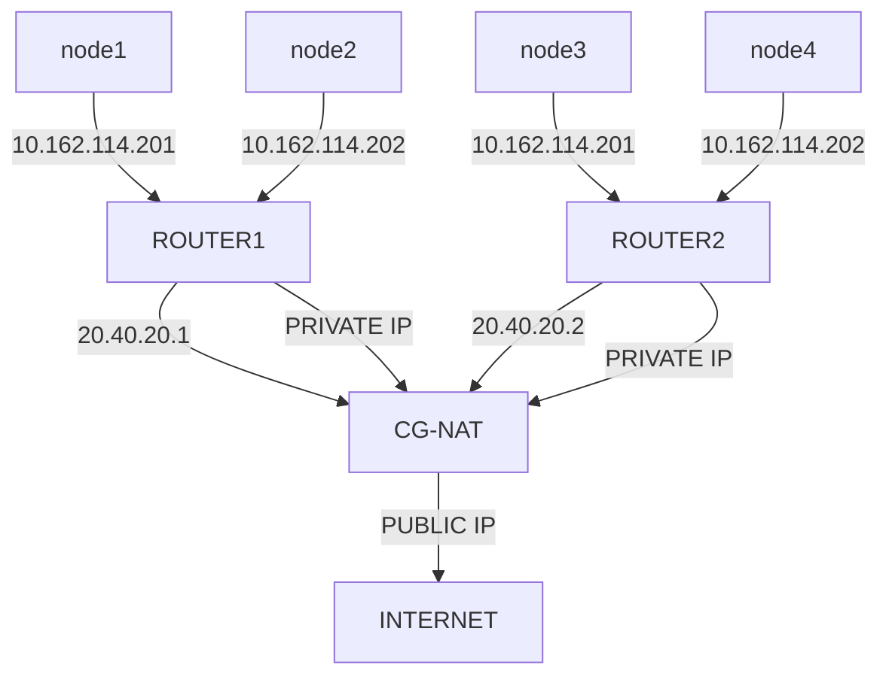
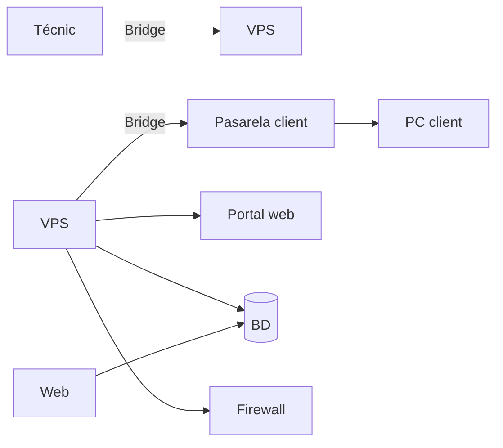

# REPO projecte-smx2b-2026-2027

Llista de projectes d'SMX2B del curs 2026-2027.

### [BoardSinc](https://github.com/Khania93/BoardSinc)

###### Context i situació inicial:

La comunitat de wargame (jocs de taula o de miniatures en què dos o més jugadors simulen conflictes militars, batalles històriques o situacions tàctiques i estratègiques) es troba amb diverses dificultats a l'hora de preparar i desenvolupar una partida.

Un dels principals inconvenients d'aquest tipus de jocs és la necessitat de disposar d'un espai físic considerable per representar els escenaris, desplegar les miniatures i gestionar els diferents elements que intervenen en una partida. Això, sumat a la quantitat de material necessari, pot dificultar-ne la pràctica, especialment en entorns domèstics o en espais amb disponibilitat limitada.

A més, la preparació de les partides sovint requereix un temps considerable, tant per al muntatge de l'escenari com per a la configuració de les unitats, la consulta de regles i la gestió dels diferents elements del joc. Aquesta complexitat també representa una barrera d'entrada per als nous jugadors, que poden trobar dificultats a l'hora d'aprendre les mecàniques, comprendre les regles i familiaritzar-se amb les diferents unitats i les seves característiques.

Tot i aquestes dificultats, un dels principals atractius dels wargames és precisament l'experiència física i tàctil que ofereixen. La manipulació de miniatures, el desplegament de les unitats sobre el terreny de joc i l'ús de daus per resoldre les accions formen part essencial de la seva identitat i contribueixen a generar una experiència immersiva, estratègica i social que molts jugadors volen preservar.

En aquest context, BoardSinc sorgeix amb l'objectiu de simplificar i fer més accessible l'experiència dels jocs de wargame, abordant les principals dificultats relacionades amb l'espai necessari, el muntatge i la configuració de les unitats, així com la iniciació de nous jugadors. Tot això, mantenint com a eix central l'ús de miniatures i daus, per preservar al màxim les sensacions, les dinàmiques i l'essència dels jocs de guerra tradicionals.

Així, el projecte busca trobar un equilibri entre la simplificació de la preparació i el desenvolupament de les partides i la conservació de l'experiència física i estratègica que caracteritza aquesta afició.

###### Abast i objectius:

Objectius generals L'objectiu principal de BoardSinc és digitalitzar tots els elements dels jocs de wargame que no siguin miniatures ni daus, amb la finalitat de simplificar i agilitzar el desenvolupament de les partides, reduir l'espai físic necessari i facilitar l'accés a nous jugadors. El projecte busca combinar els avantatges de les eines digitals amb l'experiència física dels jocs de miniatures tradicionals, mantenint la interacció directa amb les miniatures i els daus com a eixos centrals del joc. D'aquesta manera, es pretén reduir la quantitat de material físic necessari i les tasques de gestió associades, sense perdre l'essència tàctica, estratègica i social dels wargames.

###### Objectius específics

Centralitzar els elements del joc: desenvolupar una aplicació, plataforma web o eina digital que permeti reunir en un únic entorn tots els recursos necessaris per jugar, com ara cartes, fitxes (tokens), manuals, taules de referència i altres elements.
Digitalitzar les cartes i els tokens: substituir els components físics de gestió per versions digitals que permetin consultar la informació, gestionar-ne l'estat i accedir-hi de manera ràpida i intuïtiva.
Agilitzar la gestió de les unitats: facilitar la consulta i l'administració de les característiques, habilitats, estadístiques i estats de les diferents unitats durant la partida.
Facilitar l'accés a les regles i als manuals: integrar la documentació i les referències necessàries dins la plataforma per evitar consultes constants a manuals físics i reduir les interrupcions durant el joc.
Simplificar la preparació de les partides: reduir el temps necessari per organitzar els elements, configurar les unitats i preparar els recursos abans de començar a jugar.
Reduir l'espai físic necessari: disminuir la quantitat de material que cal disposar sobre la superfície de joc, mantenint únicament les miniatures, els daus i els elements físics que siguin imprescindibles.
Facilitar la iniciació de nous jugadors: oferir una interfície intuïtiva i una presentació clara de la informació que permetin comprendre les regles i les mecàniques de joc de manera progressiva.
Preservar l'experiència tradicional: mantenir les miniatures i els daus físics com a elements fonamentals, conservant la manipulació, la interacció i les decisions estratègiques pròpies dels wargames.

###### Abast del projecte

BoardSinc inclou el disseny i el desenvolupament d'una eina digital que actuï com a complement dels jocs de wargame tradicionals. Aquesta eina ha de permetre gestionar els diferents elements del joc des d'un únic entorn, facilitant-ne la consulta i l'administració durant totes les fases de la partida.

### [HoloTech360](https://github.com/Nico-Frias/HoloTech360)

#### Projecte Hologrames 
En aquest projecte, el que volem fer és implementar nu sistema d'holoframes que es pugui utilitzar en diferents situacions, ja sigui en l¡àmbit acadèmic, personal o empresarial.

Amb els hologrames volem facilitar diferents tasques, com visualtizar productes en tres dimensions, disposar d'un professor virtual que expliqui contignuts o tenir un assistent informàtic que ajudi a detectar problemes en un ordinador.

El nostre projecte es dirà HoloTech360 i consistirà en una plataforma que integrarà tres funcionalitats diferents dins d'una maetixa pàgina web.

Aquestes funcionalitats seran:

- HoloHelp: assistent virtual per detectar i explicar problemes informàtics

- HoloClass: professor virtual per ajudar en l'aprenentatge.

- HoloStore: visualitzador hologràfic de productes i components informàtics.

La nostra idea és que les tres funcionalitats es puguin utilitzar amb un mateix dispositiu hologràfic, sense necessitat de construir-ne un de diferent per a cada funció.

##### 2. Objectius del projecte 

L'objectiu principal és crear un sistema hologràfic interactiu que combini diferents coneixements que hem après durant el cicle de Sistemes Microinformatics i Xarxes locals. (SMX)

Els nostres objectius són (poden ser modificats):

- Construir una piràmide hologràfica utilitzant materials transparents. (o potser el ventilador, ho hem de decidir)

- Crear una pàgina web que permeti controlar les diferents funcionalitats.

- Implementar un sistema de diagnòstic informàtic.

- Desenvolupar un professor virtual amb continguts educatius.

- Crear un catàleg de productes informàtics que es puguin visualitzar en 3D.

- Connectar el sistema hologràfic amb un ordinador.

- Aplicar coneixements de hardware, software, xarxes i programació.

- Documentar tot el procés de desenvolupament i les proves realitzades.

##### 3. Funcionament general
El projecte estarà format per una pàgina web principal anomenada HoloTech360.

Des d'aquesta pàgina, l'usuari podrà seleccionar una de les tres funcionalitats disponibles.

Quan l'usuari seleccioni una opció, el sistema enviarà la informació al programa encarregat de controlar la visualització hologràfica.

Per aconseguir l'efecte hologràfic, utilitzarem una pantalla i una piràmide transparent que reflectirà les imatges preparades per a aquest sistema.

D'aquesta manera, podrem representar objectes, components informàtics o personatges virtuals.

Cal tenir en compte que aquest sistema no genera hologrames reals, sinó un efecte visual mitjançant el reflex de les imatges sobre una superfície transparent.

#### 4. HoloClass — Professor virtual
HoloClass serà la part educativa del nostre projecte.

La idea és crear un professor virtual que pugui explicar diferents temes mitjançant animacions i representacions hologràfiques.

Aquesta funcionalitat estarà pensada especialment per a estudiants, però també podria utilitzar-se en altres àmbits educatius.

###### 4.1. Continguts educatius
Inicialment volem centrar-nos en continguts relacionats amb el nostre cicle formatiu.

Alguns exemples serien:

Components d'un ordinador.

Funcionament del processador.

Memòria RAM.

Discos d'emmagatzematge.

Xarxes informàtiques.

Adreces IP.

Sistemes operatius.

Seguretat informàtica.

Muntatge i manteniment d'ordinadors.

###### 4.2. Funcionament de HoloClass
L'usuari entrarà a la pàgina web i seleccionarà HoloClass.

A continuació, podrà escollir el tema que vol aprendre.

Per exemple, si selecciona "Components d'un ordinador", el sistema podria mostrar una representació hologràfica d'una placa base i destacar els diferents components.

També volem afegir explicacions escrites i, si és possible, narracions d'àudio.

D'aquesta manera, l'alumne podria escoltar l'explicació mentre observa el component representat.

###### 4.3. Possibles ampliacions
En un futur, podríem implementar:

Preguntes tipus test.

Exercicis interactius.

Diferents nivells de dificultat.

Explicacions amb veu.

Un assistent que respongui preguntes sobre els continguts.

Aquestes funcions serien ampliacions, ja que primer volem aconseguir que la visualització hologràfica i la selecció dels continguts funcionin correctament.

### [Metrocount](https://github.com/huporu/Metrocount)

Desenvolupament d'una aplicacio per saber la quantitat que tan ple va el metro de Barcelona
 

##### Links

[Documentació de la API de TMB "Incluyent autobusos"](https://developer.tmb.cat/api-docs/v1 )

[Més dades per consultar de la API de TMB"](https://developer.tmb.cat/data)

##### Context

La nostra idea és fer-hi en Python una demostració de com es podria fer un comptador de persones en els vagons del metro de Barcelona perquè així a través d'una aplicació es pogués consultar que tan ocupat va el metro i llavors els passatgers poguessin decidir si és convenient entrar o no al vagó

##### Com es fara?

Resumidament, el que teníem pensat nosaltres és implementar uns sensors just a la porta dels vagons del metro perquè així compti les persones que hi passen, la nostra forma que havíem pensat d'implementar els sensors es tractaria de dos sensors, un que s'encarregui de comptar els que entren i l'altre dels que surten, si és possible fer els sensors s'actualitzin de manera ràpida i freqüent (cada 0,5 segons per exemple), i que els infrarojos sàpiguen diferenciar quan passen persones i quan no.  

 
(D'Aquest tema s'hi ha en parlaré en un altra secció sobre els que se'ns queda fora de l'abast i quins problemes podrien sorgir)

##### Problemes i fora d'abast

Els problemes d'abast en els quals ens podríem arribar a trobar és la precisió d'aquestes dades, un dels principals reptes d'aquest projecte és que les dades no podran ser 100% precises, ja que podrien sorgir problemes com que hi ha una avalancha de persones que entrin juntes al vagó i que el sensor compta com si hagués entrat una persona, però en realitat hi ha entrat dues o tres persones o inclús més.  

També en la part de recollida de dades els repetidors de wifi que hi ha que serveixen per enviar les dades cap al servidor sobre les persones podria fallar per culpa de l'alta demanda de persones que estiguessin utilitzant la xarxa 

Per això la nostra visió és fer que les dades siguin aproximades, encara que sempre hi busquem que sigui el més precís possible resulta ser que es una tasca bastant complicada saber amb exactitud la quantitat real dels passatgers, per això la nostra idea és fer una barra amb colors (per exemple de verd a vermell) en la qual hi hagi una fletxa que indiqui que tan ocupat està el tren segons les dades recollides dels sensors.

### [PackGo](https://github.com/advaro-dotcom/PackGO)
#### Projecte intermodular PackGo
##### Idea principal del projecte
La idea principal del meu projecte és crear una empresa de repartiment de paquets per als pobles, perquè penso que podria ser molt útil tant per a les grans empreses de repartiment com per als habitants dels pobles. D'aquesta manera, es podrien evitar alguns problemes relacionats amb el repartiment. Les grans empreses tenen molts problemes a l'hora de repartir paquets en pobles petits, ja que han de fer molts desplaçaments i perdre molt de temps per entregar pocs paquets. Amb aquest projecte, vull fer que el repartiment sigui més fàcil, rapid i economic. Així poder evitar problemes o retards per part de les empreses. Avui en dia tothom compra paquets a internet que han de rebre a casa, per tant serà una empresa amb una idea molt útil i utilitzable per a tothom.

##### La meva proposta
La meva proposta seria crear un punt de repartiment a cada poble, on les grans empreses deixarien tots els paquets en aquell poble. Les empreses deixarien els paquets en aquest punt i nosaltres ens encarregaríem de repartir-los per tot el poble. Tindríem diferents opcions, com per exemple treballadors amb patinets elèctrics per als paquets més petits, cotxes o furgonetes per als paquets més grans i també podríem utilitzar drons per fer alguns repartiments, pero encara s'han de fer proves.

##### Com guanyarem diners
Així, les grans empreses no haurien de perdre tant de temps repartint els paquets poble per poble i nosaltres podríem cobrar una quantitat per cada paquet que repartíssim. Gràcies a això, podríem aconseguir que els repartiments fossin més ràpids i eficients, estalviar temps a les grans empreses i fer que els habitants dels pobles rebessin els seus paquets més ràpidament.

##### Objectius del projecte
- Millorar el sistema de repartiment de paquets als pobles.
- Ajudar les grans empreses a estalviar temps i diners.
- Aconseguir que els paquets arribin als clients més ràpidament.
- Evitar problemes i retards en els repartiments.
- Treballar amb diferents empreses de repartiment.
- Oferir els nostres serveis a molts pobles.
- Utilitzar vehicles elèctrics com els patinets per reduir la contaminació.
- Tenir un bon servei tant a les empreses com als clients.
- Fer que els repartiments siguin més bons i sostenibles.

##### Esquemes del projecte
Aquí adjuntaré un parell d'esquemes del meu projecte.

 

 

### [RBridge](https://github.com/Afix-MAB/RBridge)

#### Context del projecte

Es crearà una eina per poder fer monitoratge d'equips que estiguin sota d'un CG-NAT, es resoldrà el problema de què els CG-NAT

no tenen cap manera tradicional per poder tenir ports oberts per a serveis o shells disponibles en xarxa que siguin disponibles des de 

Una xarxa pública diferent, ja que té una forma de xarxa lògica d'aquesta manera.

#### Abast del projecte

Es tindrà en compte en la creació del projecte, els usuaris que necessiten el servei de monitoratge (els clients), la forma de la xarxa lògica, s'intentarà posar en practica, el servidor privat en xarxa per poder establir la connexió i els dispositius Raspberry per inicialitzar el tunel.

#### Diagrama de Projecte

Els agents en el projecte són els següents: 

1. Xarxa

 * Tècnic - Amb el seu portàtil es podrà connectar en el VPS. 

 * WireGuard pel admin - És el túnel del tècnic fins al VPS. 

 * WireGuard pel client - És el túnel que tindrà cada client. 

 * FireWall - Per tindre un mínim de seguretat en la connexió, per només permetre la connexió a autoritzats.

 * Passarel·la - Serà la Raspberry en casa del client.

 * PC del client - On rebrà l'accés.

 * VPS -  El servidor privat que tindrem, on resideix, WireGuard (els túnels), firewall, la base de dades, el reconciliador de peticions de la web amb la bdd, i possiblement el monitoratge de connexions, memòries...

 > S'utilitzarà el VPS de forma simulada, també hauria de simular el portail web per les peticions del reconciliador per la base de dades.

2. Gestió

 * Portal web - On el tècnic demana les sessions.

 * Base de dades - On es guarden els clients, sessions...

 * Reconciliador - Compara el que té la bdd amb el que tenim posat.

 > S'està pensat utilitzar Python de forma molt bàsica per crear el reconciliador.

 * Monitoratge - Avisa si algun node falla.

3. Serveis

 * Web pública - Presenta el servei del tècnic.

4. Simulació

 * Proxmox serà l'hipervisor que usaré per crear xarxes internes, els hosts, els routers, ja que és molt més avançat que VirtualBox, i té moltes més funcionalitats que ens permetran simular-ho. 

### [Remote-Smart-Plugs](https://github.com/Manuel-G-P/remote-smart-plugs)
Aquest projecte tracta de endolls inteligents que es conectaran a la xarax i enviaran las seves variables a un servidor on podran ser vists desde una pagina web entrant amb un usuari on podras veure les avriables dels endolls agregats a la compte.

Variables: temperatura, humitat, voltatge, tensió.

L'objectiu d'aquest projecte és facilitar l'adminisstració de l'estat dels endolls de grans edificis, moltes vegades i han zones d'edificis que no ss'utilitzen, en conseqüencia si hi han endolls en mal estat no és donen compte, per tant per assolir un manteniment satisfactori dels endolls i reduir el risc d'incendi per endolls en mal estat, aquests endolls envien les seves variables i aixi poden ser monitoritzats facilment.

### [SafeTracking](https://github.com/aibale08/SafeTracking/)
#### Context
El meu projecte té com a objectiu fer que els clients online puguin monitorar el seu paquet de manera interactiva i verificar que el seu paquet no s'ha fet malbé, especialment en casos on els productes demanats siguin objectes o materials que es puguin fer malbé en entorns humits, en una temperatura específica o si és molt fràgil, com per exemple: un portàtil amb corrosió a causa d'un alt nivell d'humitat, un bloc de gel que s'ha desfet a causa d'una temperatura alta, una col·lecció de plats que s'ha trencat degut a que el paquet ha rebut molts cops durant el viatge. El projecte principalment volia que és pugui veure remotament i en temps real el transport dels paquets, però com que serià molt complicat, només podrà mostrar les dades un cop ha arribat el paquet.

#### Abast
##### Qué tindrà el sistema
1. Un sistema de cold chain per vigilar l'estat del producte 
2. Una microbit per crear un prototip del dispositiu
3. Una micro SSD per emmagatzemar les dades
4. Sensors de temperatura per detectar la temperatura
5. Sensors d'humitat per detectar l'humitat
6. Grafana per poder visualitzar les dades rebudes 
7. 2 pàgines web, una pública per veure les dades i una per configurar el dispositiu incorporat al paquet
8. Un mesurador de gravetat per mesurar els cops que ha rebut el paquet
9. Una base de dades Influx DB que es farà servir per emmagatzemar les dades que laa micro SSD ha anat recopilant al llarg del viatje
##### Què es queda fora
1. GPS per veure el transport i la ruta que està fent el transportista en temps real
2. Connexió Wi-Fi incorporada al paquet/metodé de transport per facilitar la connexió en temps real 
3. Poder regular la temperatura amb algun sistema de refrigeració i calefacció
4. Starlink connexió via satel·lit per veure paquets transportats com per exemple en el mar
5. metodés de transport especialitzats pel transport de productes amb aquesta idea
6. incorporar connexió de xarxa móbil per veure en temps real els paquets en llocs locals

### [WearSafe](https://github.com/cuencaaa11/Projecte-Roba)
WearSafe: resum del projecte

WearSafe sera una empresa que ven un rellotge intel·ligent amb GPS i un servei web. L’objectiu és que les famílies sàpiguen on és el seu fill i rebin un avís ràpid si hi ha algun perill. Nosaltres fem de l’empresa que dissenya i implanta tot el sistema
Com funciona

1. El rellotge. Porta GPS i es connecta per Wi-Fi a Internet. Cada 5 segons envia un senyal al servidor amb la posició, la bateria i l’hora. També té un botó SOS: si el nen el prem, l’avís arriba a la família a l’instant.

2. El servidor. És una màquina virtual al núvol (IaaS), accessible a wearsafe.cat amb connexió segura (HTTPS). Rep cada senyal, comprova que ve d’un rellotge autoritzat i el desa.

3. La base de dades. Guarda totes les posicions amb la seva data i hora, a més dels usuaris, les zones i les alertes. El client hi té accés a través de la web i pot consultar on ha estat el nen en un dia i una franja horària concretes. La web dibuixa el recorregut al mapa i mostra els llocs on s’ha aturat. L’historial es guarda un màxim d’un mes: les dades més antigues s’esborren soles. Així protegim la privacitat dels menors i només guardem el que cal.

4. La web. La família entra amb el seu usuari i contrasenya i hi troba:

    El mapa en directe amb la ubicació exacta del nen, la bateria i l’hora de l’última actualització.
    L’historial per dia i hora, amb el recorregut dibuixat.
    Les zones segures: es marca un lloc (casa, escola, parc) i un radi en metres o quilòmetres. Si el nen en surt, arriba una notificació.
    Les zones perilloses: la família pot marcar un riu, una carretera amb trànsit o unes obres, i rep un avís si el nen s’hi acosta.
    El llistat d’alertes i la gestió del compte.
    Una part de botiga :  on es vendran aquests rellotges de diferents colors i tamanys

5. Les alertes. Un programa del servidor revisa les dades de manera contínua. Avisa quan el nen surt d’una zona segura, entra en una zona perillosa o s’allunya massa de l’adult. També avisa si hi ha pluja, tempesta, vent fort o calor extrema a la seva posició, o si hi ha bateria baixa, SOS o el rellotge es queda sense connexió. Els avisos surten a la web i al mòbil de la família per Telegram.
Part de xarxa

Dissenyem i simulem a Packet Tracer la xarxa d’oficina de WearSafe, amb VLANs per separar administració, suport tècnic, servidors, invitats i proves de rellotges. Hi afegim DHCP, DNS, NAT i regles de seguretat (ACL). Al servidor real configurem DNS, HTTPS, firewall i còpies de seguretat.
